# Developer Guide

## Acknowledgements

Add links for any reused or adapted code, ideas, documentation, and third-party libraries.

## Design & implementation

### Architecture

The diagram below gives an overview of the main components and how they are connected.

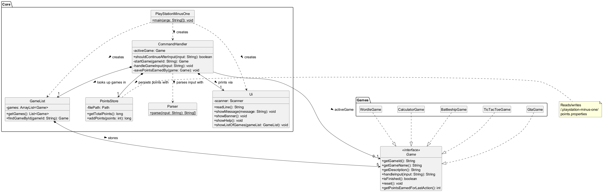

Source: [architecture.puml](diagrams/architecture.puml).

`PlayStationMinusOne` is the entry point. It creates the `Ui`, `GameList`, and `CommandHandler`, then runs a single input loop. `CommandHandler` routes launcher commands (help, list, play, quit, score, exit) and forwards game input to the active `Game`. `Parser` splits each line into a command and its arguments. `GameList` stores the five games and looks them up by ID. `PointsStore` persists the player's total points to a local properties file.

All five games — `WordleGame`, `CalculatorGame`, `BattleshipGame`, `TicTacToeGame`, and `GtaGame` — implement the `Game` interface, so `CommandHandler` can treat them uniformly without knowing their internals (Strategy pattern). A game never reads input directly; the shared loop reads each line and passes it through `handleInput()`, which keeps launcher commands reachable at every prompt.

### Command routing

The `CommandHandler` refactor moved command routing and active-game state out of the application entry point. It parses launcher commands, selects a game for `play <gameId>`, forwards other input unchanged, and resets a game after it finishes.

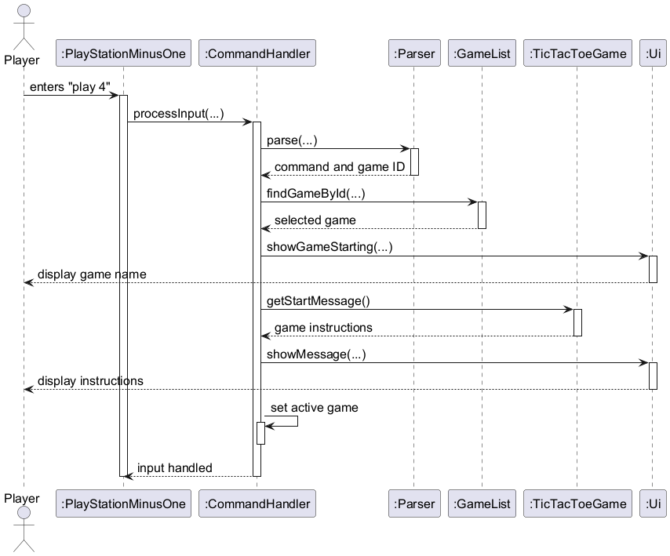

Source: [command-routing.puml](diagrams/command-routing.puml).

### Wordle game

`WordleGame` implements `Game` as game ID `1`. It selects one answer from the bundled word list for each session. Guesses must contain five letters; malformed or repeated guesses do not use a try. `WordleHelp` provides coloured feedback and tracks hints for `list letters`.

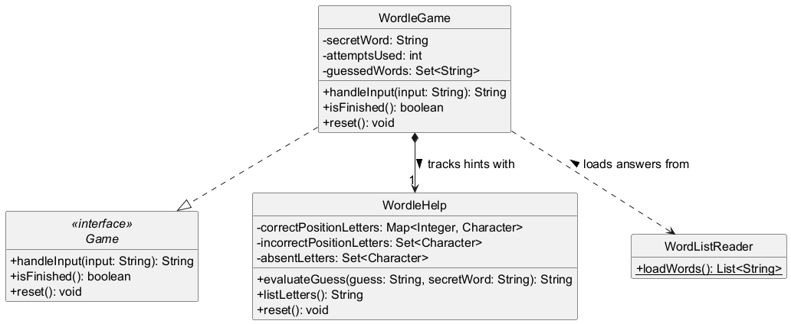

Source: [wordle-classes.puml](diagrams/wordle-classes.puml).

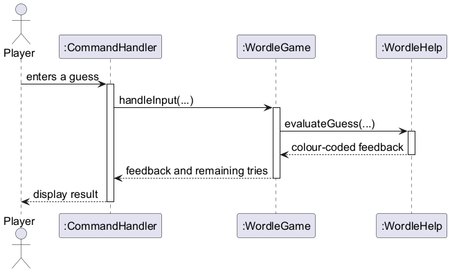

Source: [wordle-guess-sequence.puml](diagrams/wordle-guess-sequence.puml).

### Calculator game

`CalculatorGame` implements `Game` as game ID `2`. Each round shows one randomly generated arithmetic problem and grades a single line of input. `ArithmeticProblem.generate()` builds the problem and stores its own answer, so the game never recomputes it; division problems are built from a quotient and a divisor so the answer is always a whole number. The current problem, round number, and score are kept in fields instead of a loop inside the game, which is what lets the application stay at one shared command prompt.

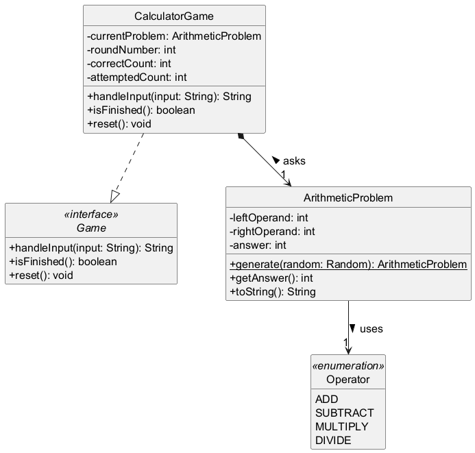

Source: [calculator-classes.puml](diagrams/calculator-classes.puml).

Input that is not a whole number is not an attempt: the counters and the current problem are left unchanged and the round is re-asked, so a typo cannot cost the player a point. A graded answer advances the round and generates the next problem. A correct answer awards one point, which `CommandHandler` reads after the round and persists through `PointsStore`. Typing `quit` ends the session and reports the rounds attempted, the number correct, and the accuracy.

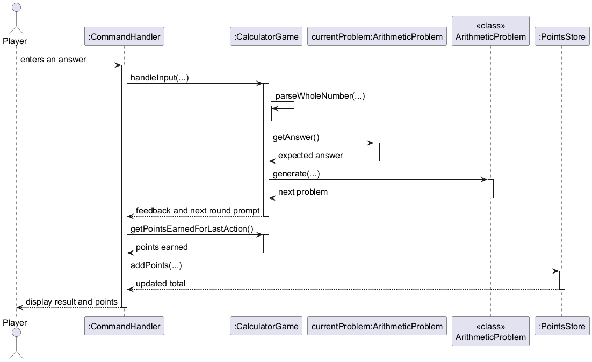

Source: [calculator-round-sequence.puml](diagrams/calculator-round-sequence.puml).

### Battleship game

`BattleshipGame` implements `Game` as game ID `3`. It manages a turn-based game against the computer. Each participant has a 7 × 7 board containing four randomly placed ships of lengths 4, 3, 2 and 1. `BattleshipBoard` handles ship placement and attacks, while `Cell` and `Ship` track occupied positions and damage. `ShotResult` reports a miss, hit, or sunk ship. Invalid or repeated coordinates do not consume a turn. The computer draws its attacks from a shuffled list to avoid repeated shots.

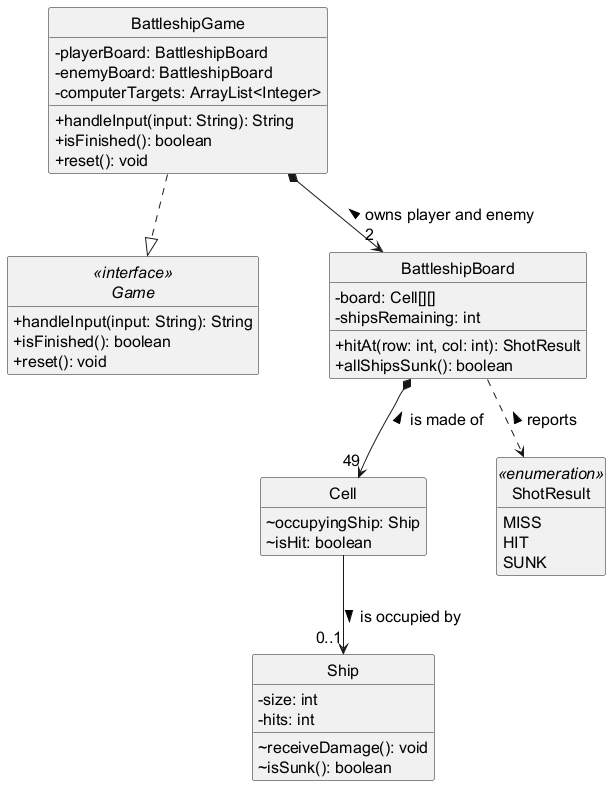

Source: [battleship-classes.puml](diagrams/battleship-classes.puml).

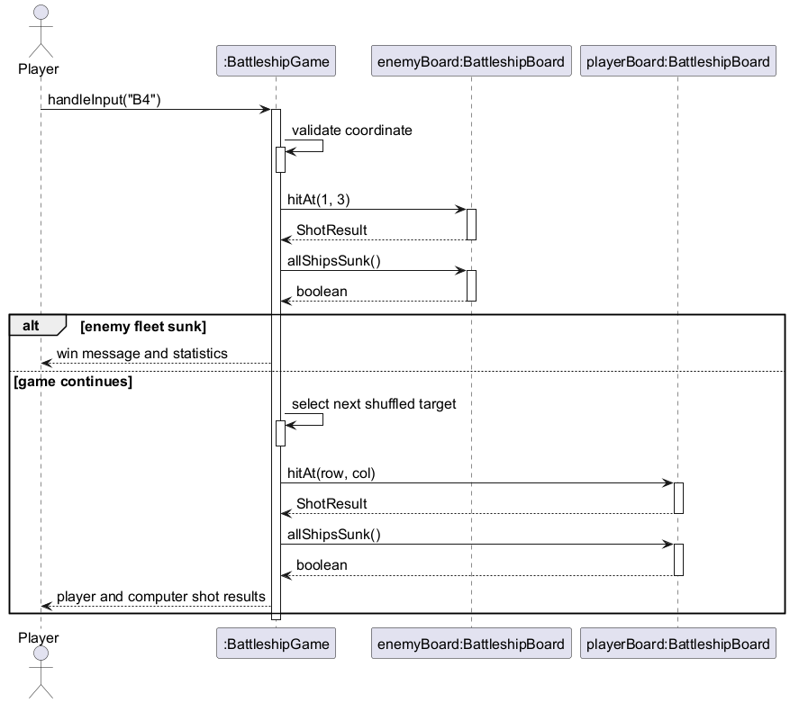

Source: [battleship-attack-sequence.puml](diagrams/battleship-attack-sequence.puml).

### Tic Tac Toe game

Tic Tac Toe is game ID `4`. The player uses `X`; the computer uses `O`. `TicTacToeGame` manages turns and session messages, while `TicTacToeBoard` stores the 3-by-3 grid and checks moves and outcomes. This separation keeps board rules in one class and turn flow in another.

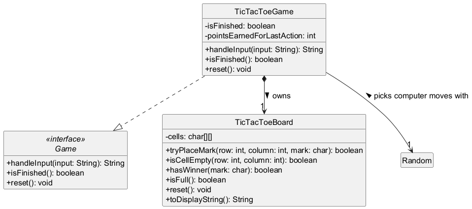

Source: [tictactoe-classes.puml](diagrams/tictactoe-classes.puml).

A move is entered as a coordinate from `A1` to `C3`. Invalid or occupied squares leave the board unchanged and do not trigger a computer move. After a valid `X` move, the game checks for a win or draw. If the game continues, it chooses randomly from the remaining empty squares, places `O`, and checks the result again. The game shows the updated board and returns to the menu when the session ends.

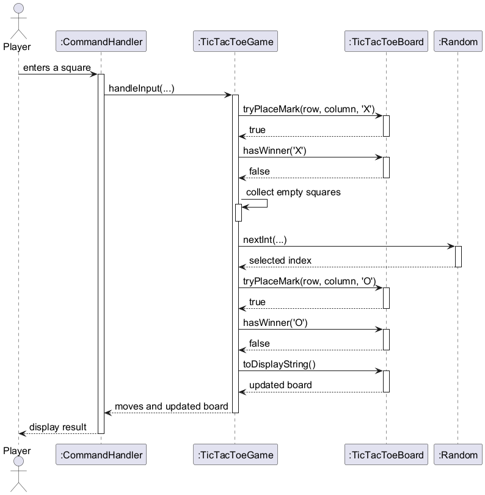

Source: [tictactoe-turn-sequence.puml](diagrams/tictactoe-turn-sequence.puml).

The computer chooses from a list of empty squares, so it cannot overwrite a mark. `TicTacToeGame` accepts an injected `Random` source, which lets tests make its moves repeatable.

### GTA -6 game

GTA -6 is game ID `5`, a choose-your-own-adventure game. The player navigates a branching story by picking numbered choices. The story is modelled as a graph of `StoryNode` objects stored in a `Map<String, StoryNode>`. Each `StoryNode` holds scenario text, choice labels, and keys pointing to the next nodes. Ending nodes have no choices and finish the session.

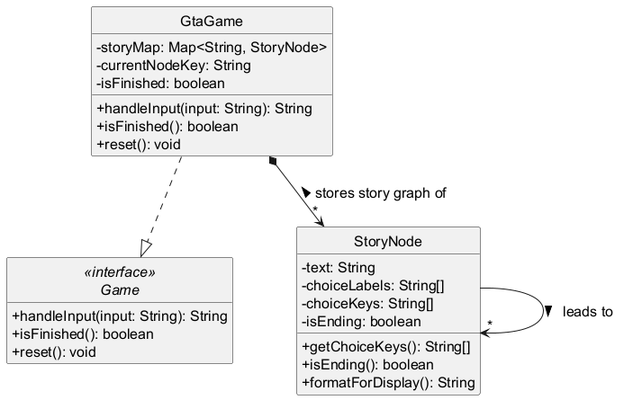

Source: [gta-classes.puml](diagrams/gta-classes.puml).

When the player enters a choice number, `GtaGame.handleInput()` looks up the current node's choice keys, advances to the next node, and returns its formatted text. If the next node is an ending, the game sets itself as finished. Invalid input re-displays the current scenario without advancing.

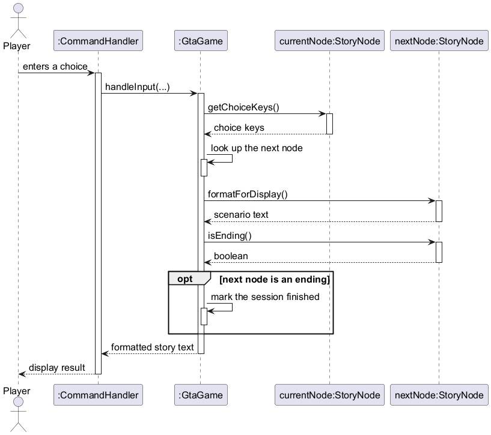

Source: [gta-choice-sequence.puml](diagrams/gta-choice-sequence.puml).

## Appendix A: Product Scope

PlayStation -1 is a set of short terminal games for people who want a quick break at the command line. The current games are Wordle, Calculator, Battleship, and Tic Tac Toe.

## Appendix B: User Stories

| As a ... | I want to ... | So that I can ... |
|---|---|---|
| new user | see the available games | choose one to play |
| player | start a game by ID | play without leaving the terminal |
| player | play Tic Tac Toe against the computer | enjoy a short turn-based game |
| player | quit a game | return to the launcher |

## Appendix C: Non-Functional Requirements

- The app works through keyboard input in a terminal.
- It displays a response before reading the next command.
- Invalid input produces an error instead of stopping the app.

## Appendix D: Glossary

- **CLI:** command-line interface, where the player enters commands in a terminal.
- **Game session:** one play of a game, from start until it ends or the player quits.

## Appendix E: Instructions for Manual Testing

1. Start the app and enter `list`; confirm Tic Tac Toe appears as game ID `4`.
2. Enter `play 4`; confirm the instructions and empty board appear.
3. Enter an invalid coordinate such as `Z9`, then an occupied square; confirm neither causes a computer move.
4. Enter valid coordinates until the game ends; confirm the result and updated board appear.
5. Enter `play 4` again; confirm the board is empty for the new session.
