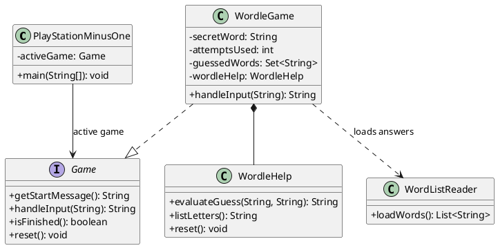
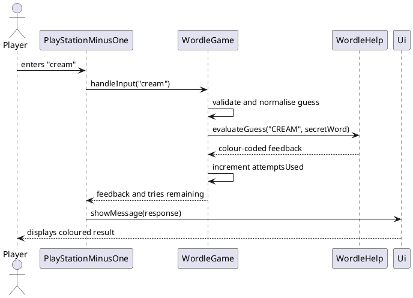
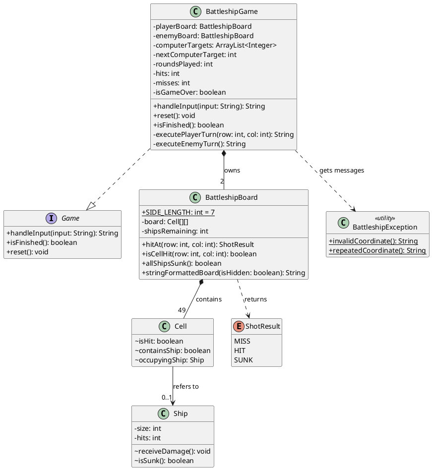
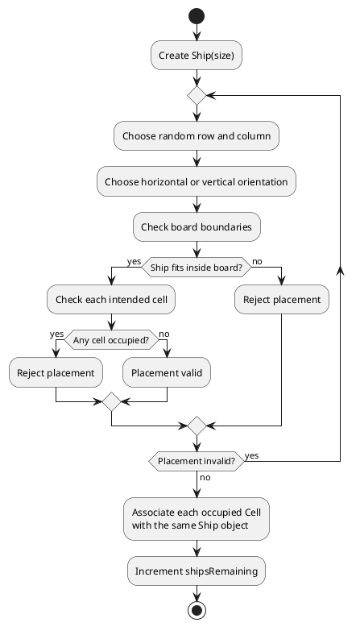
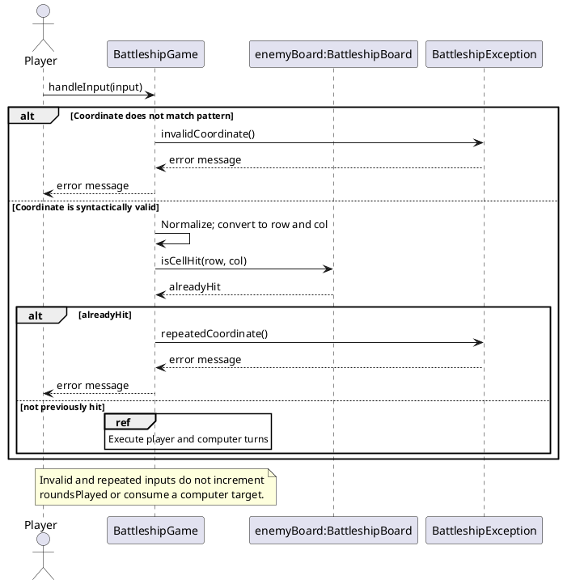
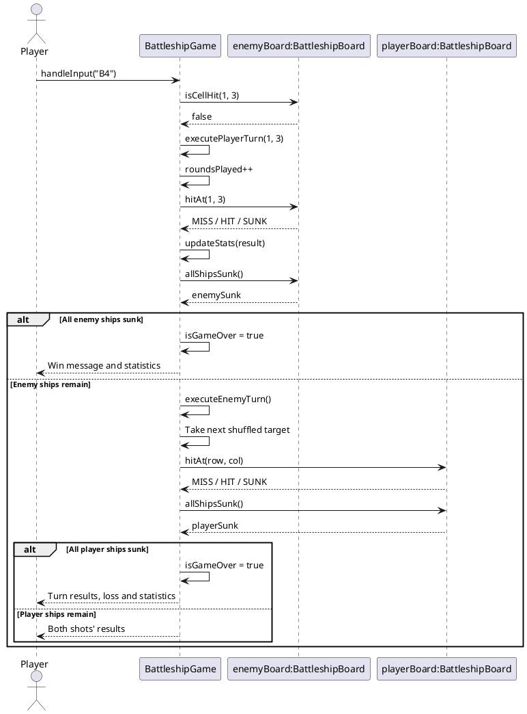

# Developer Guide

## Acknowledgements

{list here sources of all reused/adapted ideas, code, documentation, and third-party libraries -- include links to the original source as well}

## Design & implementation

The v1.0 MVP uses a small command-line interface so that each user action is
handled as one input followed by one output. The application does not use
continuous input, timers, animations, or other real-time behaviour.

### Component responsibilities

* `PlayStationMinusOne` is the application entry point. It owns the main command
  loop and coordinates the parser, user interface, and active game.
* `Parser` converts a line of user input into a command and its arguments. For
  example, `play 1` is parsed as the command `play` with the argument `1`.
* `Ui` handles console input and output, including the startup banner, prompts,
  game feedback, and error messages.
* `Game` is the common abstraction for a playable game. It defines the
  operations needed to start a game, process a command, and leave the game.
  The v1.0 will provide one Wordle-style game through this abstraction.

### v1.0 interaction model

The application processes one complete command at a time:

1. The user enters a command.
2. `Parser` identifies the command and its arguments.
3. The active component performs the requested action.
4. `Ui` displays the result and waits for the next command.

The planned v1.0 flow is:

```text
> play 1
Starting Wordle. Enter a five-letter word.

> apple
Feedback: ...

> quit
Returning to the main menu.
```

The command `play <gameId>` starts a game, where game `1` is the Wordle-style
game. Inside the game, a five-letter word submits one guess and produces feedback.
The command `quit` leaves the active game, while `exit` closes the
application. Invalid commands display an error message without crashing the
application or consuming a guess.

### Wordle game

This section describes the implementation of the Wordle enhancement. Wordle is
implemented as a `Game`, allowing it to use the launcher's common input loop
while keeping its rules and session state independent from the other games.
The launcher creates one `WordleGame` with ID `1` in `GameList`. When the user
enters `play 1`, `PlayStationMinusOne` makes that object the active game and
prints its start message. Subsequent non-launcher input is passed as the raw
line to `WordleGame.handleInput(String)`.

#### Design

`WordleGame` owns the state of one Wordle session:

* `secretWord` is the answer selected from the bundled word-list resource.
* `attemptsUsed` counts only valid, incorrect guesses. A session permits five
  such guesses.
* `guessedWords` is a `HashSet` of normalised guesses. It prevents a repeated
  guess from consuming an attempt.
* `finished` tells the launcher when it should reset the game and return to the
  main menu.
* `wordleHelp` evaluates guesses and retains the letter knowledge needed by
  the `list letters` command.

The following diagram shows the main classes and their responsibilities.



`WordListReader` loads non-empty lines from `wordle/wordle-words.txt` when
`WordleGame` is first loaded. It normalises them to uppercase and fails early
with a clear exception if the resource is missing or empty. Keeping the words
in a resource rather than in Java source makes it straightforward to expand or
replace the answer list without changing game logic.

#### Processing a guess

The sequence below shows the normal path for a valid incorrect guess. The
launcher deliberately forwards the original input rather than parsing it as a
launcher command; this lets a Wordle guess be a plain five-letter word.



`handleInput` first handles the game-specific commands `quit` and
`list letters`. It then rejects input that is not exactly five alphabetic
characters and rejects guesses already held in `guessedWords`. Neither case
changes `attemptsUsed`, so typing mistakes and duplicate guesses are fair to
the player. A new valid guess is normalised using `Locale.ROOT` before it is
stored and evaluated, making the behaviour independent of the computer's
locale and treating upper- and lower-case input identically.

For a valid guess, `WordleHelp.evaluateGuess` uses two passes. The first pass
marks exact matches green and records the unmatched letters of the secret word
with their remaining counts. The second pass examines every non-green guessed
letter: it is yellow only when an unmatched copy remains in the secret word;
otherwise it is red. This ordering is important for words containing repeated
letters: a guessed letter cannot receive more yellow marks than the answer
contains. The helper also records green, yellow, and red information for the
later `list letters` display. Stronger evidence replaces weaker evidence; for
example, a green letter is removed from the yellow and red collections.

After evaluation, `WordleGame` ends the session on a correct guess or after
the fifth incorrect guess. On a loss it reports the answer before the return
message, so the player can learn from the completed round. The launcher checks
`isFinished()`, calls `reset()`, and clears its active-game reference. Resetting
clears guesses and hints, restores the attempt counter, and selects a new
secret word so the same `WordleGame` object can safely be played again.

#### Alternatives considered

* **Evaluate each guessed letter in one pass.** This is shorter, but it
  incorrectly colours repeated letters because it cannot reserve exact matches
  before considering misplaced ones. The two-pass approach matches Wordle's
  expected feedback rules.
* **Store Wordle state in `PlayStationMinusOne`.** This would make the
  launcher responsible for game rules and would complicate adding games. Keeping
  the state in `WordleGame` preserves the `Game` abstraction and makes reset
  behaviour local to Wordle.
* **Use a list for previous guesses.** A list would preserve a history that is
  not needed for the current feature and requires a linear duplicate search.
  A `HashSet` directly expresses uniqueness and supports efficient lookup.
* **Embed the answer list in code.** A text resource separates content from
behaviour and lets the team update the available words without changing the
Wordle implementation.


### Battleship game 

#### Design overview

Battleship is a turn-based, player-versus-computer game implemented through the existing `Game` abstraction. 
Both participants have independent 7-by-7 boards. Each board contains four automatically positioned ships of lengths 4, 3, 2, and 1. 
The player enters a coordinate such as `B4`; after a valid, previously unused shot, the computer makes one shot unless the player's move has already won the game. 
The session ends when either side loses all four ships, or when the player enters `quit`.

The implementation separates **turn coordination and presentation** from **board rules and ship damage**. 
`BattleshipGame` handles commands, decides whose turn comes next, maintains session statistics, and turns results into messages. 
`BattleshipBoard` manages the grid, placement, attacks, and the remaining-ship count. 
This division is important because board rules should be reusable without depending on the command-line interface, 
while the `Game` interface allows Battleship to participate in the same launcher lifecycle as other games.

The following class diagram focuses on relationships essential to processing attacks. Utility methods and logging have been omitted to keep the diagram readable. 
`Cell` and `Ship` are package-private classes in the `battleshipboard` package; the game accesses them only through `BattleshipBoard`.



Each `BattleshipBoard` allocates a `Cell[7][7]` grid and initializes every cell before placing any ships. 
A cell contains `isHit`, `containsShip`, and an optional reference to its `occupyingShip`. 
All cells belonging to one vessel refer to the **same** `Ship` object. 
Therefore, a ship can track hits across its segments with a single counter (`Ship.hits`), and `Ship.isSunk()` simply checks whether the counter equals its `size`.

The board separately maintains `shipsRemaining`. 
This counter increases once per successfully placed ship and decreases only when `hitAt(...)` discovers that the final segment of a ship has been struck. 
The win check `allShipsSunk()` is consequently a constant-time comparison (`shipsRemaining == 0`) rather than a repeated scan of the board. 
The total starting fleet occupies ten cells (4 + 3 + 2 + 1).

`ShotResult` is an enum containing `MISS`, `HIT`, and `SUNK`. 
Returning a typed result from `BattleshipBoard.hitAt(...)` keeps game rules independent of 
presentation text: `BattleshipGame.formatShotResult(...)` can produce messages such as `Hit and sunk a ship!` without changing the board logic. 
Despite its name, `BattleshipException` is currently a **static message utility**, not a subclass of `Exception` and not an exception thrown by input validation.

#### Creating a board and placing ships

The `BattleshipBoard` constructor iterates through `SHIP_SIZES = {4, 3, 2, 1}`. 
For each size, it creates a new `Ship` and calls `placeShip(...)`. 
The method repeatedly selects a random start cell and orientation, 
then asks `canPlaceShip(...)` whether the proposed ship fits entirely inside the board and whether all proposed cells are unoccupied. 
Only after both conditions pass are those cells populated with the shared `Ship` reference.

The activity diagram shows the loop for **one ship**. The constructor repeats the activity four times, once for each size.



The checks prevent out-of-bounds access and overlapping ships. 
**Adjacency is allowed**: the implementation checks occupancy of the intended cells only, not the cells next to a ship. 
It also does not enforce a particular distribution of orientations. Random trial placement is straightforward for a small 7-by-7 board and a ten-cell fleet. 
An alternative is to generate every legal placement and randomly select one; that could offer more control over selection but would add complexity not presently needed.
The current algorithm retries until a valid location is found, with no explicit retry limit.

#### Processing commands and player attacks

`BattleshipGame.handleInput(String)` first trims the input (and converts `null` to an empty string). 
It checks for `quit`, then `board`, before treating the input as a possible shot. 
The command checks use `equalsIgnoreCase(...)`, so `BOARD` and `Quit` also work. `quit` sets `isGameOver` and returns the game statistics and exit message. 
`board` calls `getBoardDisplays()` and does **not** consume a turn.

For shot commands, the regular expression `[A-Ga-g]\\s*[1-7]` accepts a letter A-G, optionally followed by whitespace, and a digit 1-7. 
The implementation removes whitespace and uppercases the coordinate. 
It then converts to zero-based indices: for `B4`, `row = 'B' - 'A' = 1` and `col = '4' - '1' = 3`. Before calling `hitAt(...)`, the game checks `enemyBoard.isCellHit(row, col)`. 
Invalid or previously used coordinates return a validation message without advancing the game or triggering a computer turn.

The next sequence diagram isolates these early-exit branches. 
It deliberately omits the launcher and user-interface classes because the feature-specific question is whether the game changes state.



A valid new shot calls `executePlayerTurn(...)`, which increments `roundsPlayed`, attacks `enemyBoard`, and updates only the **player's** hit/miss counters. 
`BattleshipBoard.hitAt(...)` marks the cell as hit. 
If the cell is empty, it returns `MISS`; if occupied, it calls `Ship.receiveDamage()` and returns `SUNK` if `Ship.isSunk()` becomes true, otherwise `HIT`. 
When a ship sinks, the board decrements `shipsRemaining`. The game then checks `enemyBoard.allShipsSunk()`. 
If true, it marks the session finished and appends the victory message and statistics. Otherwise, `handleInput(...)` calls `executeEnemyTurn()`.

The following sequence diagram depicts the normal branch in which the player's attack **does not** immediately win the game. 
The `alt` fragment additionally shows the two possible endings.



`hitAt(...)` assumes its target has never been attacked; it contains an `assert(!cell.isHit)` rather than a runtime check. 
This makes duplicate prevention a caller responsibility: the game rejects repeated player shots and the computer's targeting scheme never repeats a coordinate. 
Developers adding new callers must enforce this precondition, especially because Java assertions are normally disabled unless enabled explicitly.

#### Computer target selection and game state

At the start of each session, `initialiseComputerTargets()` creates an `ArrayList<Integer>` holding every number from 0 to 48 and 
shuffles it with `Collections.shuffle(computerTargets, random)`. Every computer turn consumes the entry at `nextComputerTarget` and advances the index. 
The chosen integer maps back to a cell by division and remainder:

```java
int row = target / BattleshipBoard.SIDE_LENGTH;
int col = target % BattleshipBoard.SIDE_LENGTH;
```

Because the shuffled list contains each value exactly once, computer shots never repeat within a session. 
The strategy also avoids wasting random draws trying to find unused coordinates late in the game. 
Its deliberate limitation is that it is **random rather than tactical**: it does not target neighbouring cells after a successful hit. 
A future difficulty enhancement could add hunt-and-target behaviour while retaining `BattleshipBoard.hitAt(...)` and its `ShotResult` contract.

`reset()` sets `isGameOver` to false, constructs two new boards using the game's `Random` instance, resets `roundsPlayed`, `hits`, and `misses` to zero, 
and rebuilds the computer target order. This replaces all previous attack and ship state, allowing another session to start cleanly. 
`isFinished()` exposes the completion state to the launcher via `Game`. 
The `getExitMessage()` method prints rounds, successful hits, missed shots, total shots, and accuracy, 
where accuracy is `hits / (hits + misses) * 100`, or `0.00%` if no player shot occurred. Computer shots are deliberately excluded from these player statistics.

#### Showing both boards without revealing the opponent's ships

The `board` command invokes `playerBoard.stringFormattedBoard(false)` and `enemyBoard.stringFormattedBoard(true)`. 
A cell is displayed as `O` if it was hit and contains a ship, `X` if it was hit and is empty, `S` for an unhit ship when ships are visible, and `~` otherwise. 
This exposes the player's unhit ships but hides the opponent's unhit ships, while showing attacks on both boards. 
One rendering method with an `isHidden` parameter avoids duplicating the display rules.

#### Alternatives considered and trade-offs

* **One class for all game rules.** It would reduce the class count but intertwine command validation, placement, damage, and turn management. The current separation keeps board operations testable independently of terminal interaction.
* **One `Ship` instance per occupied cell.** This would make it harder to know when the complete ship has sunk. Shared object references let one `Ship` track damage across its segments.
* **String results instead of `ShotResult`.** String values would couple core game logic to exact output wording and be more susceptible to inconsistent result handling. An enum fixes the set of possible outcomes.
* **Generate a fresh random computer coordinate each turn.** This requires duplicate detection and repeated draws. A one-time shuffled permutation guarantees uniqueness with simple indexing.
* **Manually place player ships.** This could give the player more control, but requires additional commands and validation. Automatic placement better supports PlayStation -1's short, command-line sessions.
* **Count invalid shots as turns.** The chosen behaviour rejects invalid and repeated inputs without penalising player mistakes; both checks take place before `roundsPlayed` is incremented.

#### Testing and maintenance considerations

The following tests exercise both successful paths and important invariants. 
Because ship placement is random, tests requiring exact vessel locations should use controlled random inputs or inspect a known fixture rather than rely on a particular board layout.

| Scenario | Input / action | Expected behaviour |
| --- | --- | --- |
| New session | Start Battleship, enter `board` | Two 7-by-7 boards appear; enemy unhit ships are hidden. |
| Valid coordinate | Enter `B4` | Player shot is resolved; computer replies unless the player wins. |
| Whitespace and case | Enter `b 4` | Treated as `B4`. |
| Invalid coordinate | Enter `H1`, `A8` or `B44` | Validation message; no round or computer attack used. |
| Repeated coordinate | Enter `B4` twice | Second entry is rejected without a computer reply. |
| Complete ship damage | Hit every segment of a ship once | Final segment produces `SUNK`; `shipsRemaining` decreases once. |
| Board visibility | Enter `board` after shots | Hits/misses remain visible; enemy unhit ship cells remain hidden. |
| Completion | Sink every opposing ship | Correct winner announced; game is marked finished. |
| Early exit | Enter `quit` | Statistics and return-to-menu message shown; game marked finished. |
| Fresh replay | Call `reset()`/start new session | Boards, counters, target order, and completion flag reset. |

Two implementation caveats matter for future developers. 
First, ship placement currently relies on repeated random trials without an explicit maximum; a revised placement strategy could bound attempts or enumerate legal positions. 
Second, deterministic tests would be easier if `BattleshipGame` accepted an injected or seeded `Random` rather than constructing it internally. 
These are potential improvements, not features currently implemented.


## Product scope
### Target user profile

Playstation -1 is for busy individuals who work or study in a command-line
environment and want a short, clearly bounded break. It also targets retro
gaming enthusiasts and minimalists who prefer lightweight text-based games
over resource-intensive graphical games.

### Value proposition

Playstation -1 provides low-commitment CLI games that can be played in short
sessions with clear completion. Users can choose a game, interact with it using
simple commands, and receive immediate feedback without needing graphics,
animations, or a long uninterrupted session.

### v1.0 scope

The v1.0 MVP is a CLI launcher with one playable Wordle-style game. A game session
uses a fixed number of guesses, with a maximum of five valid five-letter
guesses. The session ends when the user guesses the word or uses all available
guesses.

The MVP includes:

* the existing CLI startup flow and help command;
* launching the game with `play <gameId>`;
* submitting five-letter word guesses;
* feedback after every valid guess;
* error messages for invalid input; and
* returning to the launcher with `quit`.

The MVP deliberately excludes continuous input, timers, animations, and
background processing.

### Future features outside the MVP

The following features are deferred until after the MVP:

* additional games such as 2048, Tic-Tac-Toe, modified Tetris, and a slot
  machine;
* selectable difficulty levels;
* persistent points, scores, leaderboards, and gameplay statistics;
* tracking time spent in gameplay sessions; and
* saved settings and favourite games.

## User Stories

|Version| As a ... | I want to ... | So that I can ...|
|--------|----------|---------------|------------------|
|MVP|new user|see the available CLI commands|learn how to use the application|
|MVP|user|launch the Wordle-style game|play a short game from the command line|
|MVP|user|submit a guess and receive feedback|understand my progress after each turn|
|MVP|user|exit an active game|return to the launcher without closing the application|

## Non-Functional Requirements

* The MVP must be usable entirely through keyboard input in a terminal.
* Each user command must produce a clear output before the next command is
  read.
* Invalid commands and arguments must be handled with an error message rather
  than terminating the application unexpectedly.
* The MVP must not depend on continuous screen updates, timers, or animations.

## Glossary

* *glossary item* - Definition

## Instructions for manual testing

{Give instructions on how to do a manual product testing e.g., how to load sample data to be used for testing}
