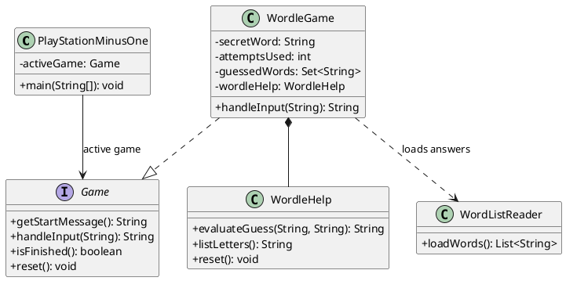
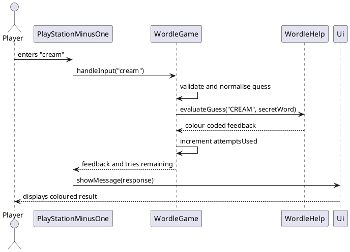

# Developer Guide

## Acknowledgements

{list here sources of all reused/adapted ideas, code, documentation, and third-party libraries -- include links to the original source as well}

## Design & implementation

The v1.0 MVP uses a small command-line interface so that each user action is
handled as one input followed by one output. The application does not use
continuous input, timers, animations, or other real-time behaviour.

### Component responsibilities

* `PlayStationMinusOne` is the application entry point. It owns the main command
  loop and coordinates the parser, user interface, and active game.
* `Parser` converts a line of user input into a command and its arguments. For
  example, `play 1` is parsed as the command `play` with the argument `1`.
* `Ui` handles console input and output, including the startup banner, prompts,
  game feedback, and error messages.
* `Game` is the common abstraction for a playable game. It defines the
  operations needed to start a game, process a command, and leave the game.
  The v1.0 will provide one Wordle-style game through this abstraction.

### v1.0 interaction model

The application processes one complete command at a time:

1. The user enters a command.
2. `Parser` identifies the command and its arguments.
3. The active component performs the requested action.
4. `Ui` displays the result and waits for the next command.

The planned v1.0 flow is:

```text
> play 1
Starting Wordle. Enter a five-letter word.

> apple
Feedback: ...

> quit
Returning to the main menu.
```

The command `play <gameId>` starts a game, where game `1` is the Wordle-style
game. Inside the game, a five-letter word submits one guess and produces feedback.
The command `quit` leaves the active game, while `exit` closes the
application. Invalid commands display an error message without crashing the
application or consuming a guess.

### Wordle game

This section describes the implementation of the Wordle enhancement. Wordle is
implemented as a `Game`, allowing it to use the launcher's common input loop
while keeping its rules and session state independent from the other games.
The launcher creates one `WordleGame` with ID `1` in `GameList`. When the user
enters `play 1`, `PlayStationMinusOne` makes that object the active game and
prints its start message. Subsequent non-launcher input is passed as the raw
line to `WordleGame.handleInput(String)`.

#### Design

`WordleGame` owns the state of one Wordle session:

* `secretWord` is the answer selected from the bundled word-list resource.
* `attemptsUsed` counts only valid, incorrect guesses. A session permits five
  such guesses.
* `guessedWords` is a `HashSet` of normalised guesses. It prevents a repeated
  guess from consuming an attempt.
* `finished` tells the launcher when it should reset the game and return to the
  main menu.
* `wordleHelp` evaluates guesses and retains the letter knowledge needed by
  the `list letters` command.

The following diagram shows the main classes and their responsibilities.



`WordListReader` loads non-empty lines from `wordle/wordle-words.txt` when
`WordleGame` is first loaded. It normalises them to uppercase and fails early
with a clear exception if the resource is missing or empty. Keeping the words
in a resource rather than in Java source makes it straightforward to expand or
replace the answer list without changing game logic.

#### Processing a guess

The sequence below shows the normal path for a valid incorrect guess. The
launcher deliberately forwards the original input rather than parsing it as a
launcher command; this lets a Wordle guess be a plain five-letter word.



`handleInput` first handles the game-specific commands `quit` and
`list letters`. It then rejects input that is not exactly five alphabetic
characters and rejects guesses already held in `guessedWords`. Neither case
changes `attemptsUsed`, so typing mistakes and duplicate guesses are fair to
the player. A new valid guess is normalised using `Locale.ROOT` before it is
stored and evaluated, making the behaviour independent of the computer's
locale and treating upper- and lower-case input identically.

For a valid guess, `WordleHelp.evaluateGuess` uses two passes. The first pass
marks exact matches green and records the unmatched letters of the secret word
with their remaining counts. The second pass examines every non-green guessed
letter: it is yellow only when an unmatched copy remains in the secret word;
otherwise it is red. This ordering is important for words containing repeated
letters: a guessed letter cannot receive more yellow marks than the answer
contains. The helper also records green, yellow, and red information for the
later `list letters` display. Stronger evidence replaces weaker evidence; for
example, a green letter is removed from the yellow and red collections.

After evaluation, `WordleGame` ends the session on a correct guess or after
the fifth incorrect guess. On a loss it reports the answer before the return
message, so the player can learn from the completed round. The launcher checks
`isFinished()`, calls `reset()`, and clears its active-game reference. Resetting
clears guesses and hints, restores the attempt counter, and selects a new
secret word so the same `WordleGame` object can safely be played again.

#### Alternatives considered

* **Evaluate each guessed letter in one pass.** This is shorter, but it
  incorrectly colours repeated letters because it cannot reserve exact matches
  before considering misplaced ones. The two-pass approach matches Wordle's
  expected feedback rules.
* **Store Wordle state in `PlayStationMinusOne`.** This would make the
  launcher responsible for game rules and would complicate adding games. Keeping
  the state in `WordleGame` preserves the `Game` abstraction and makes reset
  behaviour local to Wordle.
* **Use a list for previous guesses.** A list would preserve a history that is
  not needed for the current feature and requires a linear duplicate search.
  A `HashSet` directly expresses uniqueness and supports efficient lookup.
* **Embed the answer list in code.** A text resource separates content from
behaviour and lets the team update the available words without changing the
Wordle implementation.


## Product scope
### Target user profile

Playstation -1 is for busy individuals who work or study in a command-line
environment and want a short, clearly bounded break. It also targets retro
gaming enthusiasts and minimalists who prefer lightweight text-based games
over resource-intensive graphical games.

### Value proposition

Playstation -1 provides low-commitment CLI games that can be played in short
sessions with clear completion. Users can choose a game, interact with it using
simple commands, and receive immediate feedback without needing graphics,
animations, or a long uninterrupted session.

### v1.0 scope

The v1.0 MVP is a CLI launcher with one playable Wordle-style game. A game session
uses a fixed number of guesses, with a maximum of five valid five-letter
guesses. The session ends when the user guesses the word or uses all available
guesses.

The MVP includes:

* the existing CLI startup flow and help command;
* launching the game with `play <gameId>`;
* submitting five-letter word guesses;
* feedback after every valid guess;
* error messages for invalid input; and
* returning to the launcher with `quit`.

The MVP deliberately excludes continuous input, timers, animations, and
background processing.

### Future features outside the MVP

The following features are deferred until after the MVP:

* additional games such as 2048, Tic-Tac-Toe, modified Tetris, and a slot
  machine;
* selectable difficulty levels;
* persistent points, scores, leaderboards, and gameplay statistics;
* tracking time spent in gameplay sessions; and
* saved settings and favourite games.

## User Stories

|Version| As a ... | I want to ... | So that I can ...|
|--------|----------|---------------|------------------|
|MVP|new user|see the available CLI commands|learn how to use the application|
|MVP|user|launch the Wordle-style game|play a short game from the command line|
|MVP|user|submit a guess and receive feedback|understand my progress after each turn|
|MVP|user|exit an active game|return to the launcher without closing the application|

## Non-Functional Requirements

* The MVP must be usable entirely through keyboard input in a terminal.
* Each user command must produce a clear output before the next command is
  read.
* Invalid commands and arguments must be handled with an error message rather
  than terminating the application unexpectedly.
* The MVP must not depend on continuous screen updates, timers, or animations.

## Glossary

* *glossary item* - Definition

## Instructions for manual testing

{Give instructions on how to do a manual product testing e.g., how to load sample data to be used for testing}
