# Developer Guide

## Table of contents

- [Acknowledgements](#acknowledgements)
- [Design & implementation](#design--implementation)
  - [Architecture](#architecture)
  - [Command routing](#command-routing)
  - [Wordle game](#wordle-game)
  - [Calculator game](#calculator-game)
  - [Battleship game](#battleship-game)
  - [Tic Tac Toe game](#tic-tac-toe-game)
  - [GTA -6 game](#gta--6-game)
  - [Snake game](#snake-game)
- [Appendix A: Product Scope](#appendix-a-product-scope)
- [Appendix B: User Stories](#appendix-b-user-stories)
- [Appendix C: Non-Functional Requirements](#appendix-c-non-functional-requirements)
- [Appendix D: Glossary](#appendix-d-glossary)
- [Appendix E: Instructions for Manual Testing](#appendix-e-instructions-for-manual-testing)

## Acknowledgements

PlayStation -1 builds on the [CS2113 team-project template](https://github.com/NUS-CS2113-AY2627-S1/tp),
whose history includes the [SE-EDU Duke starter](https://github.com/se-edu/duke). The project adapts
the starter's Gradle wrapper and build layout, Checkstyle configuration, GitHub Actions workflow, and
documentation scaffolding; the PlayStation -1 games and their documentation are maintained in this
repository.

The project uses [Gradle](https://gradle.org/) for builds, [JUnit 5](https://junit.org/junit5/) for
automated tests, [JaCoCo](https://www.jacoco.org/jacoco/) for test coverage, [Checkstyle](https://checkstyle.org/)
for coding-convention checks, and the [Shadow plugin](https://gradleup.com/shadow/) to package the
executable JAR. Dependency versions and plugin configuration are recorded in `build.gradle`.

The UML diagrams are authored with [PlantUML](https://plantuml.com/). Their editable `.puml` sources
and shared style file are included in `docs/diagrams`; the diagrams follow the
[SE-EDU PlantUML guide](https://se-education.org/guides/tutorials/plantUml.html).

LLMs such as [ChatGPT](https://chatgpt.com/) and [Claude](https://www.anthropic.com/claude) assisted
with reviewing and refining selected implementation, tests, and Developer Guide updates. These changes
were reviewed and verified in the project repository.

## Design & implementation

### Architecture

The diagram below gives an overview of the main components and how they are connected.

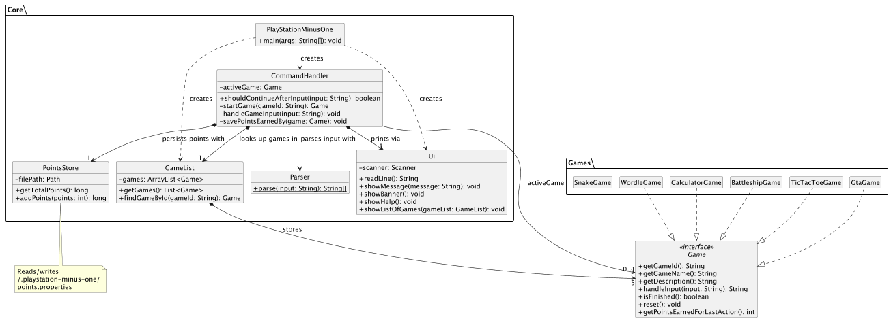

Source: [architecture.puml](diagrams/architecture.puml).

`PlayStationMinusOne` is the entry point. It creates the `Ui`, `GameList`, and `CommandHandler`, then runs a single input loop. `CommandHandler` routes launcher commands (help, list, play, quit, score, exit) and forwards game input to the active `Game`. `Parser` splits each line into a command and its arguments. `GameList` stores the six games and looks them up by ID. `PointsStore` persists the player's total points to a local properties file.

All six games — `WordleGame`, `CalculatorGame`, `BattleshipGame`, `TicTacToeGame`, `GtaGame`, and `SnakeGame` — implement the `Game` interface, so `CommandHandler` can treat them uniformly without knowing their internals (Strategy pattern). A game never reads input directly; the shared loop reads each line and passes it through `handleInput()`, which keeps launcher commands reachable at every prompt.

### Command routing

The `CommandHandler` refactor moved command routing and active-game state out of the application entry point. It parses launcher commands, selects a game for `play <gameId>`, forwards other input unchanged, and resets a game after it finishes.

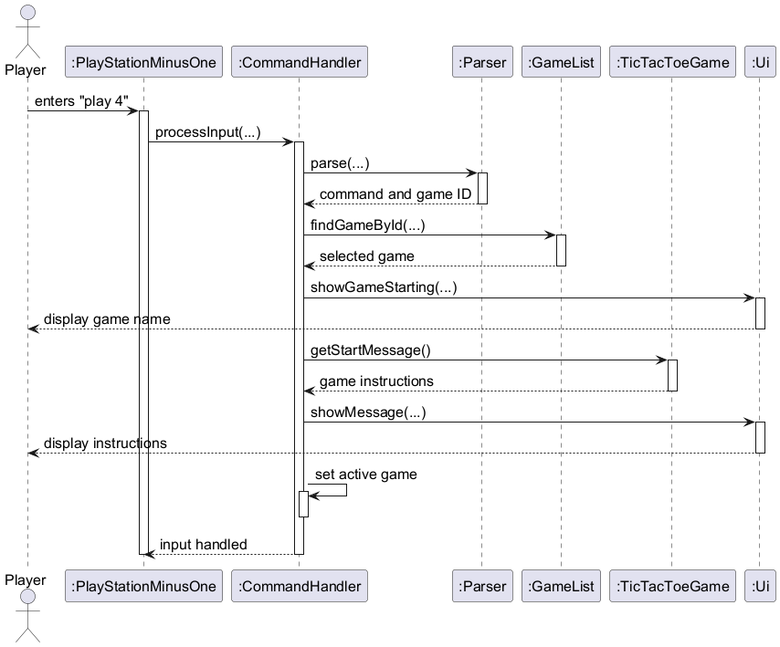

Source: [command-routing.puml](diagrams/command-routing.puml).

### Wordle game

`WordleGame` implements `Game` as game ID `1`. It selects one answer from the bundled word list for each session. Guesses must contain five letters; malformed or repeated guesses do not use a try. `WordleHelp` provides coloured feedback and tracks hints for `list letters`. When a session ends, the player quits, or the application exits during play, Wordle reports the number of valid guesses as
`Tries taken to guess: <count>`.

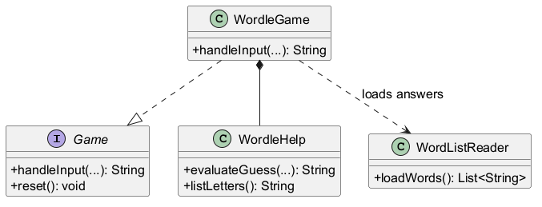

Source: [wordle-classes.puml](diagrams/wordle-classes.puml).

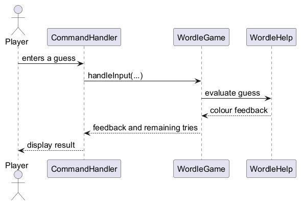

Source: [wordle-guess-sequence.puml](diagrams/wordle-guess-sequence.puml).

### Calculator game

`CalculatorGame` implements `Game` as game ID `2`. Each round shows one randomly generated arithmetic problem and grades a single line of input. `ArithmeticProblem.generate()` builds the problem and stores its own answer, so the game never recomputes it; division problems are built from a quotient and a divisor so the answer is always a whole number. The current problem, round number, and score are kept in fields instead of a loop inside the game, which is what lets the application stay at one shared command prompt.

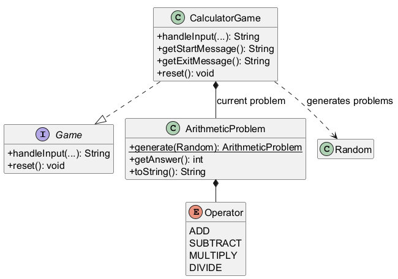

Source: [calculator-classes.puml](diagrams/calculator-classes.puml).

Input that is not a whole number is not an attempt: the counters and the current problem are left unchanged and the round is re-asked, so a typo cannot cost the player a point. A graded answer advances the round and generates the next problem. A correct answer awards one point, which `CommandHandler` reads after the round and persists through `PointsStore`. Typing `quit` ends the session and reports the rounds attempted, the number correct, and the accuracy.

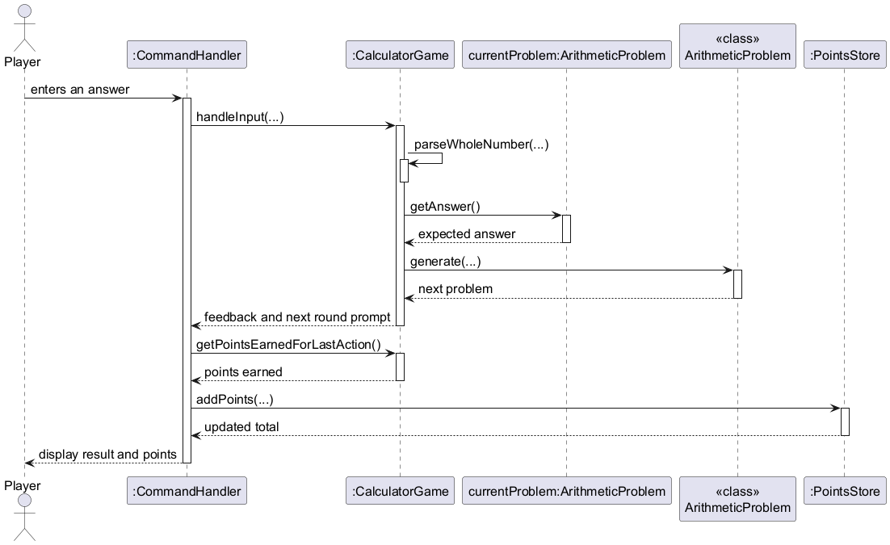

Source: [calculator-round-sequence.puml](diagrams/calculator-round-sequence.puml).

### Battleship game

BattleshipGame implements Game as game ID 3 and manages turn-based gameplay against the computer. Each player has a 7 × 7 BattleshipBoard containing four randomly placed ships of lengths 4, 3, 2 and 1.

BattleshipBoard manages ship placement and attack outcomes. Each Cell records whether it contains a ship and whether it has been attacked, while Ship tracks damage and sinking. Attacks return a ShotResult (MISS, HIT or SUNK), separating board logic from gameplay and user-facing messages.

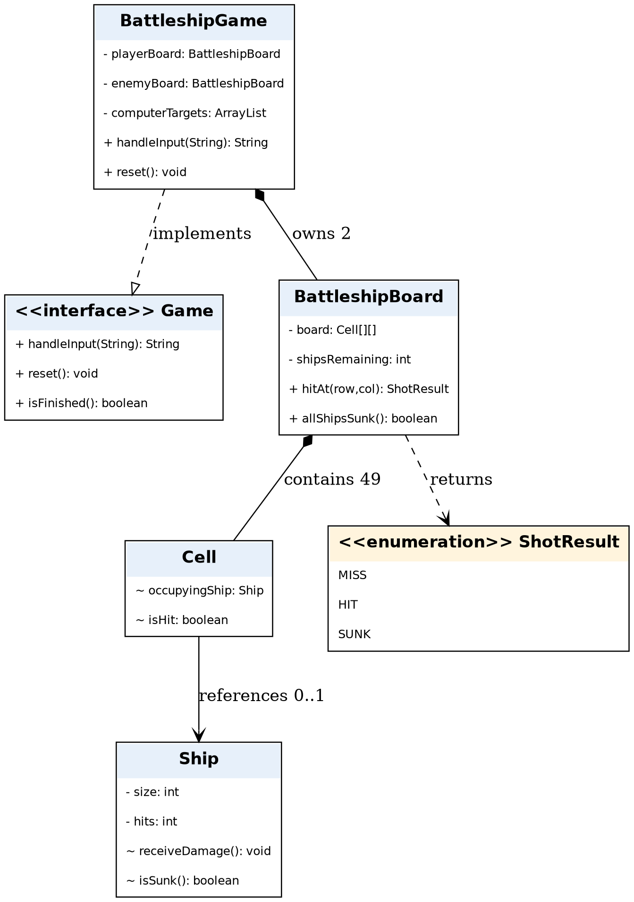

Source: [battleship-classes.puml](diagrams/battleship-classes.puml).  

When a player enters a coordinate, BattleshipGame validates it before calling BattleshipBoard.hitAt(). Invalid or repeated coordinates do not consume a turn. After a valid attack, the game updates the player's statistics and checks for victory. If the game continues, the computer attacks using the next coordinate from a shuffled list of all 49 cells, ensuring that it never targets the same cell twice.

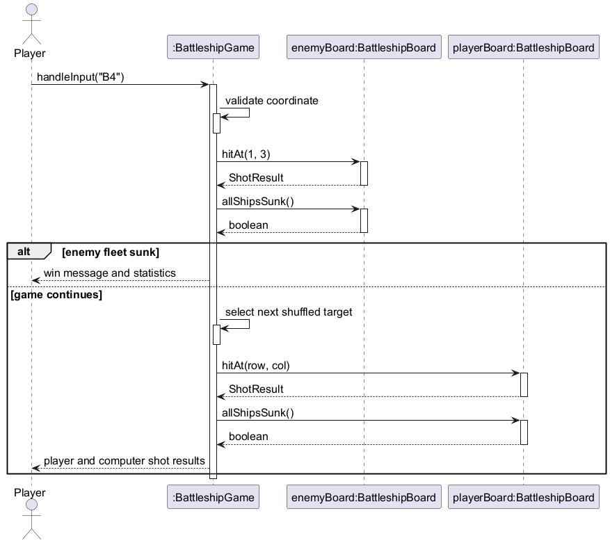

Source: [battleship-attack-sequence.puml](diagrams/battleship-attack-sequence.puml).  

The game ends when either side sinks all opposing ships or the player quits. Session statistics are displayed and the game is reset.

### Tic Tac Toe game

Tic Tac Toe is game ID `4`. The player uses `X`; the computer uses `O`. `TicTacToeGame` manages turns and session messages, while `TicTacToeBoard` stores the 3-by-3 grid and checks moves and outcomes. This separation keeps board rules in one class and turn flow in another.

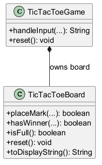

Source: [tictactoe-classes.puml](diagrams/tictactoe-classes.puml).

A move is entered as a coordinate from `A1` to `C3`. Invalid or occupied squares leave the board unchanged and do not trigger a computer move. After a valid `X` move, the game checks for a win or draw. If the game continues, it chooses randomly from the remaining empty squares, places `O`, and checks the result again. The game shows the updated board and returns to the menu when the session ends.

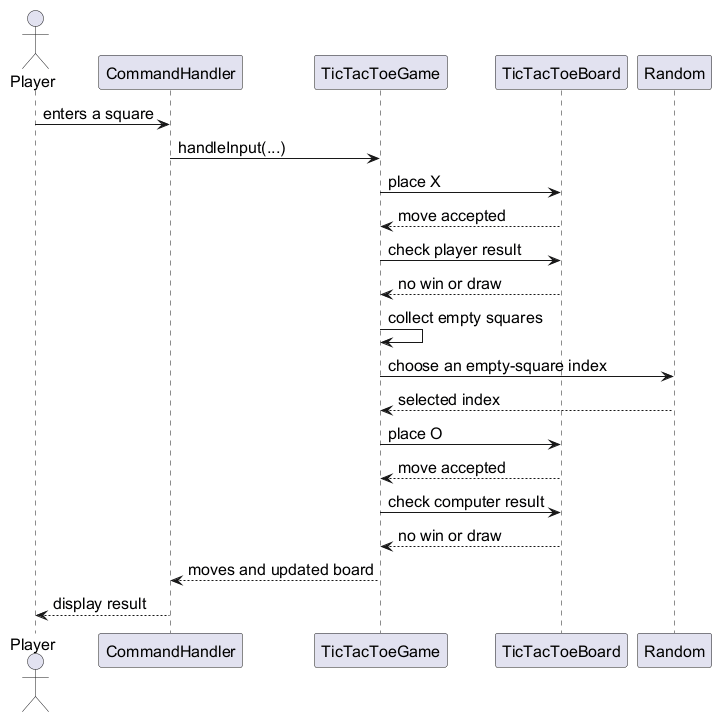

Source: [tictactoe-turn-sequence.puml](diagrams/tictactoe-turn-sequence.puml).

The computer chooses from a list of empty squares, so it cannot overwrite a mark. `TicTacToeGame` accepts an injected `Random` source, which lets tests make its moves repeatable.

### GTA -6 game

GTA -6 is game ID `5`, a choose-your-own-adventure game. The player navigates a branching story by picking numbered choices. The story is modelled as a graph of `StoryNode` objects stored in a `Map<String, StoryNode>`. Each `StoryNode` holds scenario text, choice labels, and keys pointing to the next nodes. Ending nodes have no choices and finish the session.

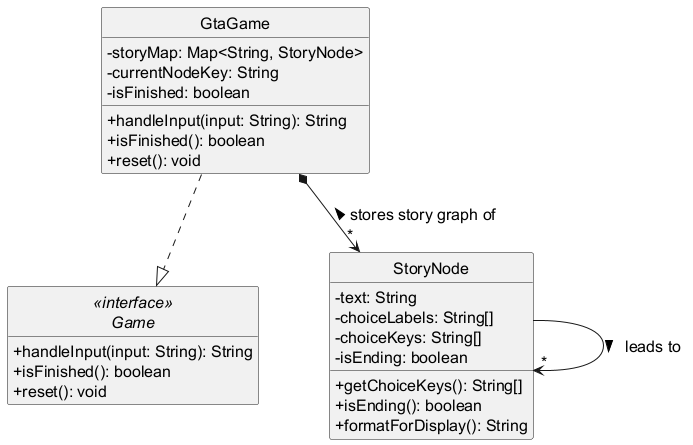

Source: [gta-classes.puml](diagrams/gta-classes.puml).

When the player enters a choice number, `GtaGame.handleInput()` looks up the current node's choice keys, advances to the next node, and returns its formatted text. If the next node is an ending, the game sets itself as finished. Invalid input re-displays the current scenario without advancing.

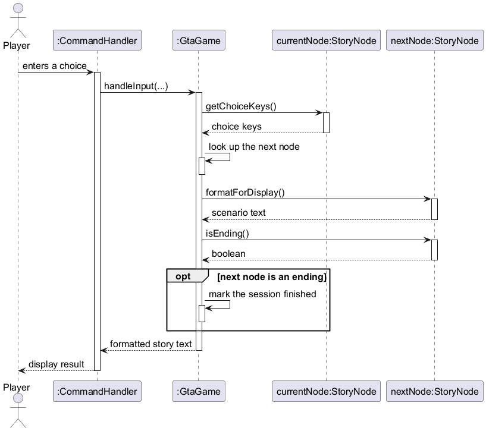

Source: [gta-choice-sequence.puml](diagrams/gta-choice-sequence.puml).

### Snake game

Snake is game ID `6`, a turn-based adaptation of the classic snake game. The player steers the snake one step per input using `w`/`a`/`s`/`d` (direction) or `f` (continue forward). The snake grows when it eats food and the game ends on a wall or self collision.

`SnakeGame` implements `Game` and delegates board state to `SnakeBoard`. `SnakeBoard` stores the snake body as a `LinkedList<int[]>` for O(1) head and tail operations, tracks the current `Direction`, and manages food placement via an injectable `Random`. The `Direction` enum stores row/column deltas and provides an `opposite()` method to reject 180-degree reversals. `SnakeBoard.advance()` returns a `MoveResult` enum (`MOVED`, `ATE_FOOD`, or `COLLISION`) so that `SnakeGame` can decide the response without inspecting board internals.

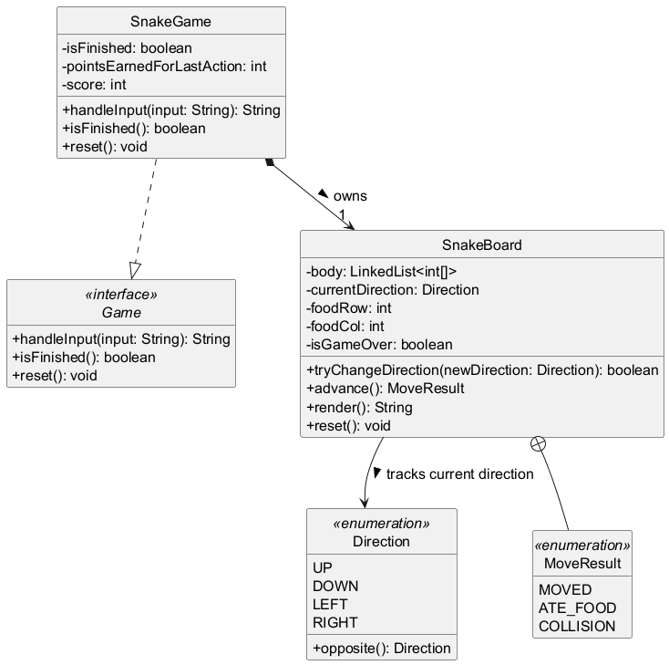

Source: [snake-classes.puml](diagrams/snake-classes.puml).

When the player enters a direction, `SnakeGame.handleInput()` parses it, attempts a direction change via `tryChangeDirection()`, and advances the snake. The sequence diagram below shows the three possible outcomes after `advance()`.

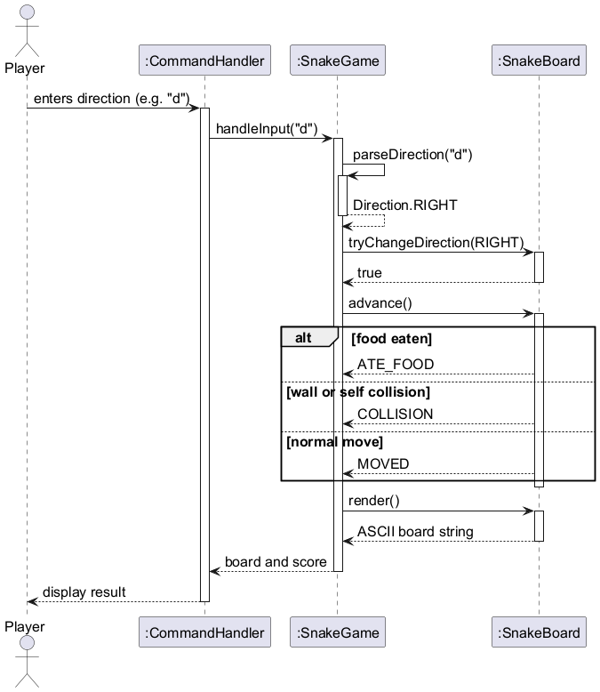

Source: [snake-turn-sequence.puml](diagrams/snake-turn-sequence.puml).

Invalid inputs and reversed directions are rejected without advancing the snake, matching the pattern used by Tic Tac Toe for invalid coordinates. `SnakeGame` accepts an injected `Random` source so tests can control food placement deterministically.

## Appendix A: Product Scope

PlayStation -1 is a set of short terminal games for people who want a quick break at the command line. The current games are Wordle, Calculator, Battleship, Tic Tac Toe, GTA -6, and Snake.

## Appendix B: User Stories

| As a ... | I want to ... | So that I can ... |
|---|---|---|
| new user | see the available games | choose one to play |
| player | start a game by ID | play without leaving the terminal |
| player | play Tic Tac Toe against the computer | enjoy a short turn-based game |
| player | play a turn-based Snake game | enjoy a quick arcade-style game in the terminal |
| player | quit a game | return to the launcher |

## Appendix C: Non-Functional Requirements

- The app works through keyboard input in a terminal.
- It displays a response before reading the next command.
- Invalid input produces an error instead of stopping the app.

## Appendix D: Glossary

- **CLI:** command-line interface, where the player enters commands in a terminal.
- **Game session:** one play of a game, from start until it ends or the player quits.

## Appendix E: Instructions for Manual Testing

1. Start the app and enter `list`; confirm Tic Tac Toe appears as game ID `4`.
2. Enter `play 1`, then enter `AAAAA`; confirm Wordle displays feedback. Enter `list letters`, then enter
   `AAAAA` again; confirm the repeated guess is rejected. Enter `quit` to return to the menu.
3. Enter `play 2`, then enter `hello`; confirm the Calculator reports that the input is not a whole number and
   re-displays the same problem. Enter `quit`; confirm the session summary appears.
4. Enter `play 3`, then enter `Z9`; confirm the coordinate is rejected. Enter `A1`, then enter `A1` again;
   confirm the repeated coordinate is rejected. Enter `quit`; confirm statistics appear.
5. Enter `play 4`; confirm the instructions and empty board appear. Enter `Z9`, then `A1`, then `A1` again;
   confirm the invalid and occupied squares do not trigger a computer move. Enter valid coordinates until the
   game ends, then enter `play 4` again; confirm the board is empty for the new session.
6. Enter `play 5`, then enter `9`; confirm the current scenario and valid choice range are shown again. Enter
   `1` to advance the story, then enter `quit`; confirm the app returns to the menu.
7. Enter `play 6`; confirm the instructions and initial board appear with the snake (`@##`) and food (`*`).
   Enter `x`; confirm the invalid command is rejected. Enter `a`; confirm the reversal is rejected (starting
   direction is right). Enter `d` a few times; confirm the snake moves right. Enter `s` then `d` to turn;
   confirm the snake changes direction. Enter `quit`; confirm the final score is shown.
